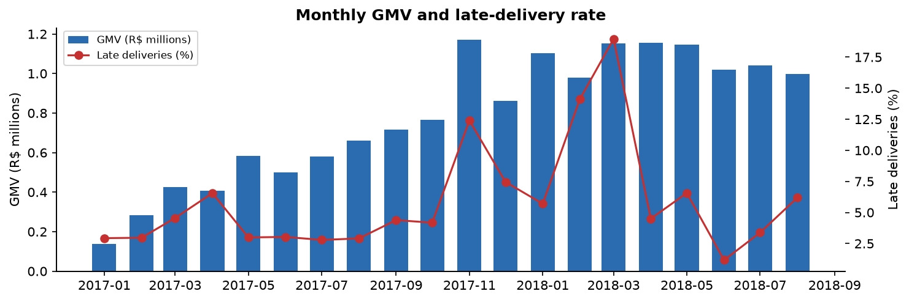
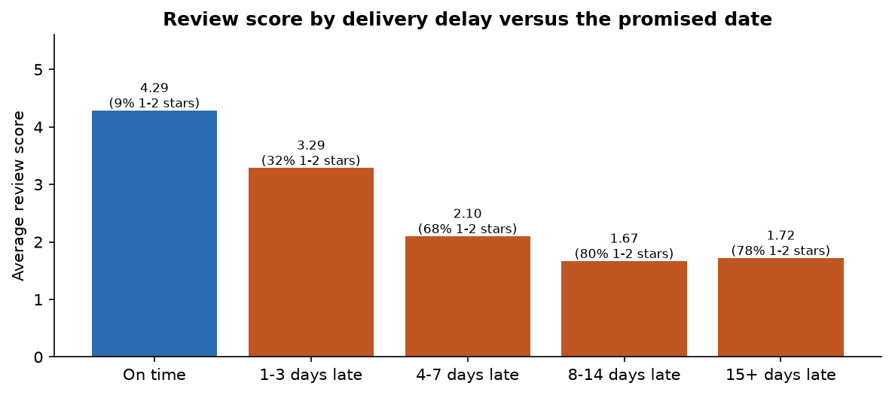
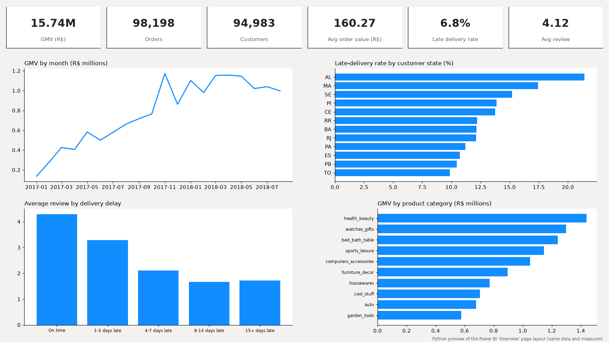

# Olist Marketplace: Retention, Customer Lifetime Value and Delivery Experience

**Why do Olist customers not come back, and what should the business fix first?** This project builds a
SQL warehouse from Olist's public marketplace data (98,198 orders, 2016-09 to 2018-08),
measures how delivery performance shapes reviews and repeat purchases, segments customers, forecasts
lifetime value, and turns the results into an Excel business case and a Power BI report.

**Tools:** SQL (DuckDB star schema, window functions) · Python (pandas, statsmodels, scikit-learn, SciPy) ·
Statistics (Mann-Whitney, ordered logit, logistic regression, bootstrap) · CLV (BG/NBD + Gamma-Gamma) ·
Excel (scenario model) · Power BI (TMDL semantic model, DAX, PBIR report)



## Results

1. **Retention is the gap.** 97.0% of 94,983 customers ordered only once; on average 0.48% of a monthly cohort orders again the next month.
2. **Late deliveries drive bad reviews.** Late orders average 2.27 stars against 4.29 on time (difference -2.02, 95% CI -2.06 to -1.98; Mann-Whitney p < 0.001). Holding distance, order value, freight share, basket size and category fixed, an ordered logit puts the chance of a 1-2 star review at 59.9% for late orders versus 9.8% on time.
3. **Lateness is concentrated.** 6.8% of deliveries are late overall; the worst large states are CE (13.8%, 1,279 orders), BA (12.2%, 3,256 orders), RJ (12.1%, 12,350 orders).
4. **No clear retention penalty yet.** Customers whose first order arrived late re-ordered within 180 days at 2.79% versus 3.20% (difference -0.41 pts, 95% CI -0.95 to +0.13; logistic regression odds ratio 0.88, p = 0.22). The direction is negative but the interval includes zero.
5. **The CLV model is well calibrated.** Fitted on orders to 2018-02-28, BG/NBD predicted 736 repeat purchase days in the next 26 weeks against 712 actual (+3.3%). Refitted on all data, it expects 1,559 repeat purchases worth R$237,233 in the next 12 months, 2.0% of last year's GMV.
6. **Where the value sits.** 'New high-value' customers (14,647) hold 28.2% of GMV; 'At-risk high-value' customers (13,985, last order about 13 months ago) hold 27.5%.



## Recommendations

1. Fix delivery promises first in CE, BA, RJ: renegotiate carriers or pad the estimated date there. Reaching an average review of 4.20 needs 95.5% of deliveries on time, against 93.3% today.
2. Score sellers on late rate and 1-2 star share every month (seller scorecard in Power BI) and cap promises for the worst offenders.
3. Test a second-order voucher on 'New high-value' customers with a holdout group. At R$10 per voucher and a 15% contribution margin it must lift the 180-day repeat rate by 2.2 pts (from 3.2%) to break even.
4. Do not count on retention gains from delivery fixes in the business case until a test confirms them; the measured review effect alone justifies the delivery work.

## Deliverables

| Deliverable | Where |
|---|---|
| Power BI project: TMDL semantic model, 14 DAX measures, 2 report pages | `dashboards/powerbi/OlistRetention.pbip` |
| Star-schema extracts used by Power BI | `dashboards/powerbi/data/` |
| Excel business case (delivery, retention, voucher break-even, sensitivity) | `excel/retention_economics_model.xlsx` |
| Analysis notebook with outputs | `notebooks/olist_analysis.ipynb` |
| One-page memo | `reports/memo.md` |
| SQL warehouse: load, staging, 20 quality rules, star schema, cohorts, KPIs | `sql/` |
| Result tables and figures | `reports/tables/`, `reports/figures/` |



The Power BI project was generated from code and its report files validate against Microsoft's
published PBIR JSON schemas. Power BI Desktop runs on Windows only, so the preview above is a Python
rendering of the Overview page from the same data. To open the real report on Windows: open
`OlistRetention.pbip` in Power BI Desktop, set the `DataFolder` parameter (Transform data > Edit parameters)
to the full path of `dashboards/powerbi/data/`, and click Refresh. See `dashboards/powerbi/README.md`.

## How it works

1. **Warehouse** (`sql/01-04`): DuckDB loads the nine CSVs, stages and cleans them, runs 20 data-quality
   rules ([`docs/data_quality_log.md`](docs/data_quality_log.md)), and builds `fact_orders`, `fact_order_items`,
   `dim_customer` (one row per person via `customer_unique_id`), `dim_seller`, `dim_product` and `dim_date`.
2. **Business views** (`sql/05-08`): cohort retention, delivery KPIs by state, seller scorecard and monthly KPIs
   with month-over-month growth and rolling sums.
3. **Statistics** (`src/analysis.py`): Mann-Whitney test and bootstrap CI for reviews, an ordered logit with
   controls, and a logistic regression of 180-day repeat purchase on first-delivery lateness.
4. **Segmentation**: rule-based RFM segments plus K-means on log RFM (k chosen by silhouette).
5. **CLV** (`src/clv.py`): BG/NBD and Gamma-Gamma implemented by maximum likelihood, validated on a 26-week holdout.
6. **Business case**: Excel formulas over the measured figures; Power BI model and report generated by `src/powerbi.py`.

Details: [`docs/methodology.md`](docs/methodology.md) · data dictionary: [`docs/data_dictionary.md`](docs/data_dictionary.md)

## Run it

```bash
python -m venv .venv && source .venv/bin/activate
pip install -r requirements.txt
make all        # download data, build warehouse, run analysis, execute notebook, run tests
```

## Project structure

```
├── data/                 raw/ and processed/ (git-ignored); README with source and licence
├── sql/                  DuckDB SQL: load, staging, quality rules, star schema, cohorts, KPIs
├── src/                  pipeline: data, analysis, CLV, figures, Excel, Power BI, report
├── notebooks/            executed analysis notebook
├── excel/                retention economics model
├── dashboards/powerbi/   .pbip project (SemanticModel + Report), CSV extracts, preview
├── reports/              results.json, memo, figures, tables
├── docs/                 methodology, data dictionary, data quality log
└── tests/                pytest suite
```

## Data

Olist, *Brazilian E-Commerce Public Dataset by Olist*, downloaded from Olist's repository
[github.com/olist/work-at-olist-data](https://github.com/olist/work-at-olist-data) (also on Kaggle as
`olistbr/brazilian-ecommerce`). Licence CC BY-NC-SA 4.0. Raw files are not stored in this repository.

## Assumptions and limits

* Contribution margin (15%) and voucher value (R$10) are assumptions.
* Orders after 2018-08-31 are excluded because the last weeks of the source are incomplete.
* Observational data: lateness effects are associations with controls, not randomized estimates.
* Review scores exist only for reviewed orders; customers who never review are not represented in review statistics.
